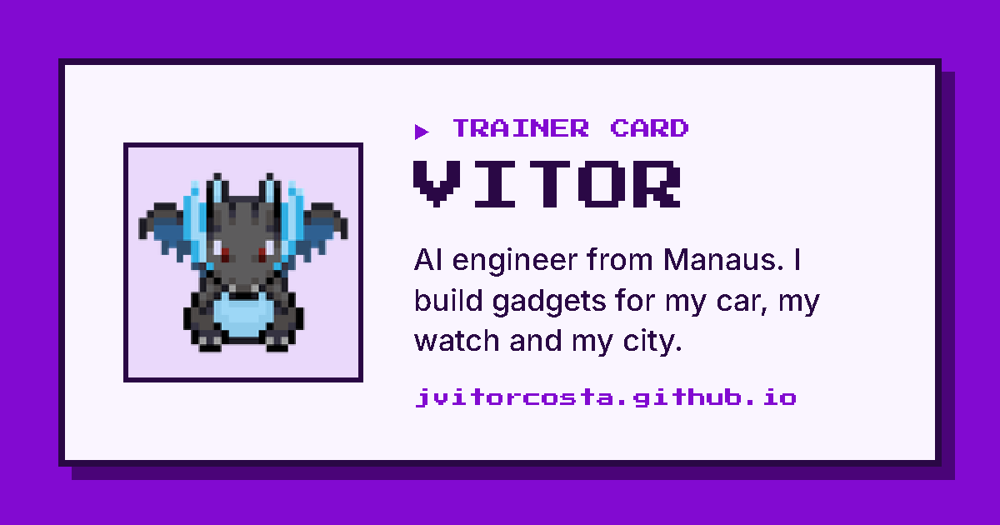

# jvitorcosta.github.io

My corner of the internet: who I am, what I'm listening to, watching and reading lately, and the gadgets I build for my car, my watch and my city.

**Live:** https://jvitorcosta.github.io



## What's on the page

- **Lately:** the last song on Spotify, film on Letterboxd, book on Goodreads and activity on Strava, refreshed twice a day.
- **My party:** the projects I'm proudest of, as tiles, each linking to a case study or its repo.
- **Recent repos:** my latest public GitHub repos, pulled from the GitHub API.
- **Work:** a one-line summary and the companies I've worked with.

It works in English and Portuguese and has three colour themes, all with no tracking and no cookies.

## How it works

A small Python package (`homepage/`, standard library only) renders a single static `index.html`:

1. A GitHub Actions workflow runs twice a day (05:00 and 17:00 in Manaus) and on every push to `main`.
2. It fetches each source. A source that fails keeps its last good value, so the page never goes blank.
3. Covers and posters are downloaded into `assets/live/`, so visitors never load images from third-party sites.
4. The page is published straight to GitHub Pages. What the build must remember between runs lives on the `state` branch, never on `main`.
5. A source that stays quiet for over a week turns the run red, so I get an email.

The project case pages in `projects/` are generated from my [curriculum-vitae](https://github.com/jvitorcosta/curriculum-vitae) repo and copied in.

More detail in [docs/deploy.md](docs/deploy.md).

## Run it locally

Needs [uv](https://docs.astral.sh/uv/).

```bash
uv run --python 3.12 python -m homepage
python -m http.server 8000
```

Then open http://localhost:8000.

## Tests

```bash
uv run --python 3.12 --group dev pytest
```

The tests cover parsing each source, fallbacks when a source breaks, colour contrast of every theme (WCAG AA), and the deploy workflow's state handling.

## Editing the content

All hand-written text lives in `data/`, so content changes never touch code:

| File | What it holds |
|---|---|
| `data/strings.toml` | every piece of page text, in English and Portuguese |
| `data/party.toml` | the project tiles |
| `data/links.toml` | profile links |
| `data/activity.toml` | the activity row when Strava is off |
| `data/pc_box.toml` | the PC box |
