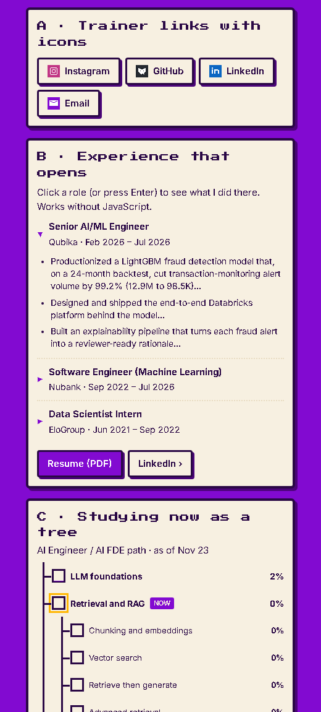

# UX review and improvement plan, November 2026

João likes how the site looks and wants strategic changes that make it easier to use, starting
with three ideas: icons on the four contact buttons, experience entries that open to show what I
did there, and Studying now as a knowledge tree. This note holds the references, a review of the
current page, and the approach chosen for each. The look stays: pixel avatar, both palettes, the
handheld-menu boxes (see [design.md](design.md)).

Screenshots of today's page are in [img/](img/): `baseline-desktop-nu.png`,
`baseline-desktop-night.png` and `baseline-phone-nu.png` (375 px). The mockup of the three ideas
is [mockups/ux-2026-11.html](mockups/ux-2026-11.html), rendered in `img/mockup-nu.png` and
`img/mockup-night.png`.

## Review of the current page

Checked at 375 px in the built-in browser, plus the repo's own tests and CSS.

| Area | Finding |
|---|---|
| Layout at 375 px | No horizontal scroll. One column, Lately first. Good. |
| Structure | One `h1`, five `h2`, `header` / `main` / `nav` / `footer` landmarks, every image has an `alt` (decorative ones empty). Good. |
| Contrast | Both palettes pass WCAG AA, checked by `tests/test_assets.py`. Good. |
| Motion | Stops under `prefers-reduced-motion`. Good. |
| Keyboard | Everything is a native `a`, `button` or `details`, so Tab and Enter work. Focus rings exist on the Studying now summaries; the buttons rely on the browser default. Worth a visible `:focus-visible` on `.links a`. |
| Skip link | None. The page is short and the header is two buttons, so the cost is low, but a "skip to content" link is cheap. |
| Tap targets | 40 of the clickable elements measure under 44 px tall. Almost all are the Studying now subtopic rows (30 px, fine for WCAG 2.2 AA's 24 px minimum, tight for thumbs) and the "How my resume is built" link (24 px). |
| Experience | Title, company and dates only. Recruiters who want more must open the PDF. This is the biggest gap against who the page is for. |
| Studying now | One card; a click opens a nested list of 9 topics, 42 subtopics, 138 concepts. It works but reads as a long list, not as a path. |
| Dark mode | There is none on purpose: both palettes are light (`color-scheme: light`), and a white palette was removed to keep colours testable. Not changing it. |
| Weight | About 47 KB HTML, 20 KB CSS, 8 KB JS, 60 KB of fonts that load (latin subsets), no framework, no third-party requests. The biggest single file is `assets/party/open-radars-manaus-map.svg` at 278 KB; converting it would be a separate, optional saving. |

Two things the review does **not** recommend: a JS framework (nothing here needs one) and
animations on the new parts (the page already has two moving things).

## Idea 1 · Icons on Instagram, GitHub, LinkedIn and Email

**References**

1. [Simple Icons](https://simpleicons.org) and its [npm package](https://npmjs.com/package/simple-icons): about 3,000 brand SVGs, CC0, the usual source for portfolio social icons. The marks are public domain but the brands are trademarks, so they stay small and link to my own profiles.
2. [Simple Icons on Iconify](https://icon-sets.iconify.design/simple-icons/): same set, individual SVGs without npm.
3. The site's own [tools/pixel_icons.py](../tools/pixel_icons.py): Spotify, Letterboxd, MyAnimeList, Goodreads and Strava are already 20×20 pixel tiles in brand colours.

**Chosen approach.** Do not mix in smooth vector logos. Draw four more 20×20 tiles with the same
generator (Instagram magenta, GitHub charcoal, LinkedIn blue, Email in Nu purple), show them at
20 px inside the existing buttons, `alt=""` because the word is already there. Zero new
requests per icon beyond four tiny SVGs (about 1.5 KB each), same `versioned()` cache busting.

## Idea 2 · Experience that opens

**References**

1. [Adrian Roselli, Progressively Enhanced HTML Accordion](https://adrianroselli.com/2023/08/progressively-enhanced-html-accordion.html): native `details` first, script only for extras.
2. [WebAIM, Disclosure widgets](https://webaim.org/techniques/disclosures/): keyboard, naming and state rules.
3. [web.dev, Details and summary](https://web.dev/learn/html/details): built-in keyboard support and the `[open]` selector for a rotating chevron.
4. [Chrome's accordion guidance](https://developer.chrome.com/docs/modern-web-guidance/guides/ui-components/accordion.md.txt): avoid exclusive accordions, so several roles can stay open.
5. [21st.dev, experience timeline](https://21st.dev/@kedhareswer/components/pigment-experience-ledger.md): the same idea in a portfolio, each employer a row that opens in place.

**Chosen approach.** One `
` per role, closed except the newest, no JavaScript needed and
several can be open at once. The summary keeps today's title, company and dates; the body lists
the bullets of the public resume (`resume/resume.md` in curriculum-vitae, the same text as the
PDF), word for word, grouped as in the resume. The resume button and PDF stay as they are. This
changes one design rule ("Experience shows title, company and dates, nothing more"), so the PR
updates design.md on purpose. Open question for João in PR 2: the bullets exist only in
English; they would show in English on the Portuguese page (marked `lang="en"`) unless he wants
approved Portuguese text.

## Idea 3 · Studying now as a knowledge tree

**References**

1. [Prodigy Engineering, Skill Trees for adaptive learning](https://medium.com/prodigy-engineering/skill-trees-for-adaptive-learning-729760e5dd00): why they chose plain SVG over canvas libraries, and why too many edges hurt readability.
2. [niyue/skillmap](https://github.com/niyue/skillmap): skills as nodes coloured by status with progress bars and prerequisite edges.
3. [xelearning/roadmap](https://github.com/xelearning/roadmap): a roadmap editor in plain SVG, HTML, CSS and JS, no library.
4. [GitHub Skill Tree Generator](https://devpost.com/software/github-skill-tree-generator): a generated SVG tree in the style of roadmap.sh.

**Chosen approach.** Generate the tree at build time as inline SVG from
`data/study-progress.json` (no library, no runtime fetch). Because the card sits in a 340–460 px
column, the tree runs **top to bottom**, not left to right: a trunk with nine topic nodes, each a
pixel square that fills with its percent, the current topic ringed and tagged NOW. Opening a topic
branches out its subtopics, then concepts. Same data, same colours, `details`-based fallback list
for no JS and for screen readers (the SVG is `aria-hidden`, the list is the accessible version).
The numbers stay generated by `tools/study_progress.py`.

## Order of work

1. This note (docs only).
2. PR 1: the four icons.
3. PR 2: experience entries that open.
4. PR 3: the Studying now tree.

Each PR comes with screenshots in Nu Purple and Red Lantern at desktop and 375 px. Both palettes
are light, so "light and dark" here means those two.
